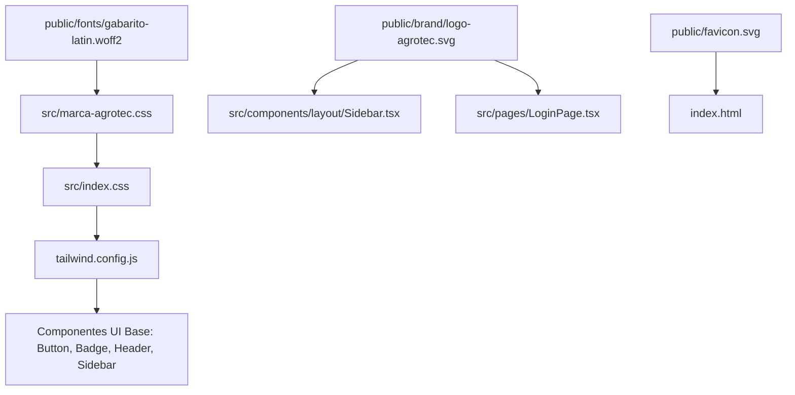

# Implementation Plan: F01 — Base del Proyecto y Tokens de Identidad Visual Agrotec

**Branch**: `001-base-marca` | **Fecha**: 2026-10-13 | **Estado**: Ready

---

## 1. Resumen Ejecutivo
Establecer la infraestructura visual base del proyecto mediante la consolidación de la capa de marca oficial de Agrotec S.A., sirviendo la tipografía Gabarito de forma local con licencia SIL OFL, el logo corporativo oficial (`logo-agrotec.svg`), el favicon con las hojas del isotipo, la suite de pruebas automatizadas con Vitest y la verificación de compilación y linting.

---

## 2. Arquitectura y Componentes Afectados

### Componentes Involucrados:
- `app/marca-agrotec.css` y `src/marca-agrotec.css`: Hoja de estilos central y fuente de verdad de tokens.
- `public/fonts/gabarito-latin.woff2` y `public/fonts/OFL-gabarito.txt`: Tipografía local y licencia.
- `public/brand/logo-agrotec.svg`: Logo vectorial oficial.
- `public/favicon.svg`: Isotipo de hojas de marca en `#1C5A34` y `#8A2733`.
- `tailwind.config.js`: Integración de paleta corporativa y font-family `Gabarito`.
- `src/components/ui/Button.tsx`: Variantes `primary` y `secondary` con estilos de marca.
- `src/components/ui/Badge.tsx`: Badges con tokens oficiales.
- `src/components/layout/Header.tsx`: Borde izquierdo verde de 4 px.
- `src/components/layout/Sidebar.tsx`: Navegación con elemento activo (`#E8F0EB`, `#1C5A34`, barra izquierda de 4 px) y tarjeta de cuenta regresiva limpia.
- `src/pages/LoginPage.tsx`: Fondo neutro `#F5F5F5` y tarjeta blanca con borde `#E4E4E4`.
- `package.json` y `tests/domain.test.ts`: Vitest como runner de pruebas.

---

## 3. Estrategia de Implementación

1. **Fase 1: Verificación de Activos y Tipografía:**
   - Confirmar la presencia de `gabarito-latin.woff2`, `OFL-gabarito.txt`, `logo-agrotec.svg` y `favicon.svg`.
   - Verificar que no existan llamadas externas bloqueantes a Google Fonts en `index.html`.
2. **Fase 2: Consolidación de Tokens:**
   - Validar que `marca-agrotec.css` declare todas las variables `--marca-*`.
   - Sincronizar Tailwind para permitir su uso tanto por variables CSS como por utilidades de clase.
3. **Fase 3: Pruebas y Validación:**
   - Ejecutar suite de pruebas unitarias (`npm.cmd test`).
   - Ejecutar linter (`npm.cmd run lint`).
   - Validar tipos con `npm.cmd run build`.
4. **Fase 4: Verificación Visual:**
   - Inspeccionar la aplicación en el navegador integrado en escritorio y móvil.

---

## 4. Riesgos y Mitigaciones

| Riesgo | Probabilidad | Impacto | Mitigación |
|---|---|---|---|
| Fuentes bloqueantes externas en index.html | Baja | Medio | Eliminar preconnect innecesarios y servir Gabarito 100% local. |
| Inconsistencia de contrastes en botones o badges | Baja | Medio | Comprobar contraste mínimo AA (4.5:1) con fondo blanco/verde. |
| Regresiones en la suite de pruebas | Baja | Alta | Ejecutar Vitest de forma automatizada antes de cada commit. |
