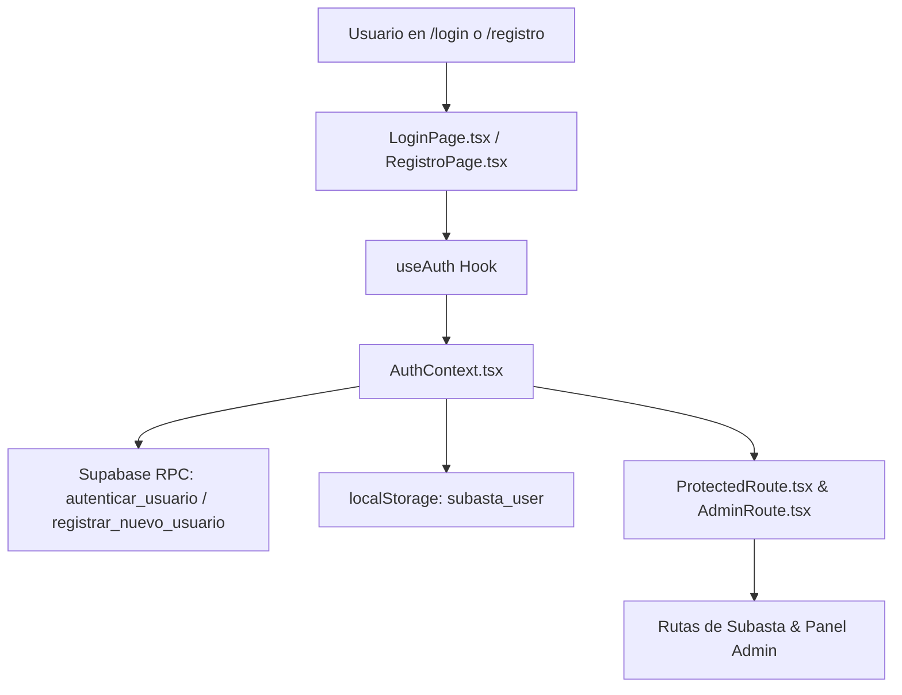

# Implementation Plan: F02 — Autenticación por Cédula y Seguridad de Acceso

**Branch**: `002-auth-cedula` | **Fecha**: 2026-10-13 | **Estado**: Ready

---

## 1. Resumen Ejecutivo
Implementar de punta a punta la autenticación exclusiva por Cédula de Identidad (`ci_documento`), registro y activación de colaboradores pre-cargados, bloqueo temporal tras 5 intentos fallidos consecutivos, RBAC estricto (Admin, Usuario, Visitante), protección de rutas (`ProtectedRoute`, `AdminRoute`), cierre de sesión e integración visual corporativa de Agrotec en las vistas `/login` y `/registro`.

---

## 2. Arquitectura de Componentes de Autenticación

---

## 3. Estrategia de Implementación

1. **Fase 1: Pruebas Unitarias de Autenticación (`tests/auth.test.ts`):**
   - Validar las reglas de validación de contraseña en cliente (`validatePassword`).
   - Validar la lógica de roles y permiso de puja (`puedeOfertar(usuario)`).
   - Validar el comportamiento de guardado y remoción de sesión.
2. **Fase 2: Robustecer `AuthContext.tsx` y Sanitización:**
   - Normalizar `ci.trim()` y asegurar tipado estricto.
   - Manejar mensajes de error descriptivos provenientes de la RPC (bloqueo por 15 minutos, cuenta inactiva, etc.).
3. **Fase 3: Estilización Oficial en `/registro` y Ajustes en `/login`:**
   - Alinear `RegistroPage.tsx` al estándar de diseño de Agrotec (logo oficial `/brand/logo-agrotec.svg`, fondo `#F5F5F5`, tipografía Gabarito, sin degradados oscuros genéricos ni cajas con letra "A").
   - Asegurar accesibilidad de contraste y feedback de éxito/error.
4. **Fase 4: Verificación Integral:**
   - Ejecutar `npm.cmd test`, `npm.cmd run lint` y `npm.cmd run build`.
   - Verificar visualmente los flujos con el navegador integrado.

---

## 4. Riesgos y Mitigaciones

| Riesgo | Probabilidad | Impacto | Mitigación |
|---|---|---|---|
| Inconsistencia entre validación de contraseña en frontend y backend | Baja | Alto | Alinear regex idéntico en `validatePassword` con la función SQL. |
| Fuga de sesiones por almacenamiento local inválido | Baja | Medio | Capturar excepciones en `JSON.parse` y limpiar storage si los campos requeridos no están presentes. |
| Intento de oferta por administradores | Baja | Crítico | Validación estricta con `puedeOfertar` tanto en frontend como en RPCs de puja. |
