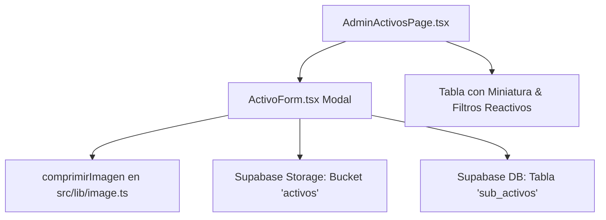

# Implementation Plan: F03 — Gestión de Activos y Carga de Fotos (Panel Admin)

**Branch**: `003-activos-fotos` | **Fecha**: 2026-10-13 | **Estado**: Ready

---

## 1. Resumen Ejecutivo
Consolidar el módulo de administración de inventario de activos en `/admin/activos` permitiendo a los administradores registrar, editar, filtrar y eliminar equipos, incorporando una columna visual de fotografía miniatura en la tabla, validaciones estrictas de precio base no negativo en USD, compresión WebP en cliente y subida directa a Supabase Storage (bucket `activos`), bajo la estética corporativa de Agrotec.

---

## 2. Arquitectura y Flujo de Componentes

---

## 3. Estrategia de Implementación

1. **Fase 1: Pruebas Unitarias de Validación de Activos (`tests/activos.test.ts`):**
   - Validar reglas de precio base ($\ge 0$, no nulo, no negativo).
   - Validar estados válidos ('Disponible', 'Cerrado', 'Adjudicado').
   - Validar categorías permitidas (1, 2, 3, 4).
   - Validar filtros de búsqueda por texto.
2. **Fase 2: Mejoras en UI y Tabla Administrativa:**
   - En `AdminActivosPage.tsx`: agregar columna de miniatura de imagen con fallback visual accesible, pulir diseño de tabla, botones y modales.
   - Optimizar `useActivos.ts` desestructurando dependencias para eliminar warnings de React Compiler / oxlint.
3. **Fase 3: Calidad y Verificación Visual:**
   - Ejecutar `npm.cmd test`, `npm.cmd run lint` y `npm.cmd run build`.
   - Verificar visualmente en navegador con el subagente de navegación.
4. **Fase 4: Cierre, Merge y Sincronización:**
   - Marcar F03 completada en `docs/sdd/backlog.md`, commitear, fusionar en `main` y subir al repositorio remoto.
